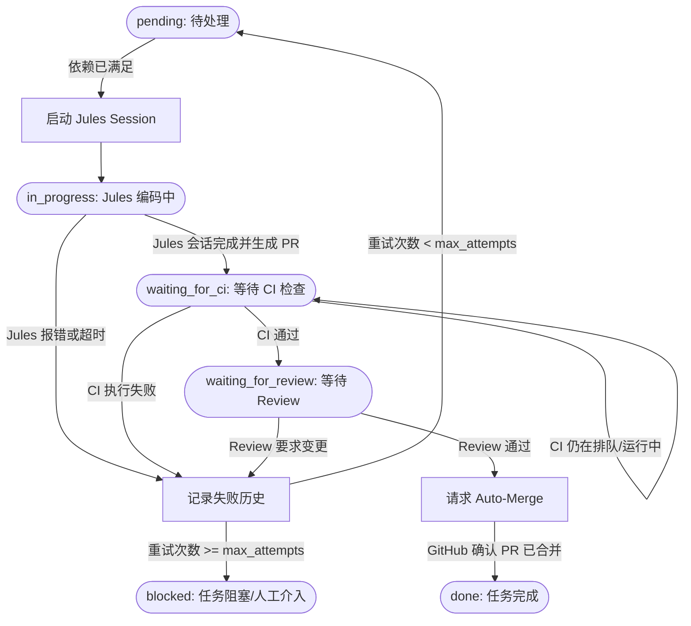

# Jules Auto 🤖🚀

[](https://github.com/DaviDWCN/jules-auto/actions/workflows/api-ci.yml)
[](https://github.com/DaviDWCN/jules-auto/actions/workflows/jules-worker.yml)
[](https://www.python.org/)
[](LICENSE)

`jules-auto` 是一个基于 **Google Jules REST API** 与 **GitHub Actions** 的全自动 AI 编程任务编排与持续交付系统。

它通过结构化的任务待办列表（Backlog），驱动 Jules 智能体自主理解需求、编写代码并提交 Pull Request，同时深度集成 GitHub CI/CD 与合并门禁（Merge Gates），实现从需求派发到自动化合并的无人值守全生命周期管理。

---

## 🌟 核心特性

- **🤖 自动化 Jules 会话管理**：自动读取待办任务的需求描述与验收标准（Acceptance Criteria），构建 Prompt 并调用 Jules `/v1alpha/sessions` 发起编码会话。
- **🔗 任务拓扑与依赖管理 (DAG Dependencies)**：支持任务间的前后置依赖配置，严格在前置依赖任务合并状态变为 `done` 后自动解锁后续任务。
- **🔄 崩溃恢复与会话对齐 (Crash Recovery - Rule 1)**：
  - 调度器崩溃或重启时，自动查询 Jules 活跃会话并对齐未完成任务，避免重复创建多余 Session；
  - 自动忽略已失败历史或已完成的旧会话；
  - 出现多会话匹配冲突时自动标记为 `blocked` 并告警，确保状态安全。
- **🛡️ 智能重试与失败上下文注入 (Smart Retries - Rule 2)**：
  - 任务失败时自动清空失效会话指针，记录完整的失败历史（Session ID、失败原因、时间戳）；
  - 达到最大重试次数（`max_attempts`）前自动调度重试；
  - 重试时自动将前序失败的报错原因注入新 Prompt，指导 Jules 进行针对性修复与迭代。
- **🚦 智能合并门禁 (Merge Gates - Rule 3)**：
  - **精细化 CI 状态判定**：智能区分 `pending`、`failure` 与 `success`，避免在 CI 构建中被误判为失败；
  - **Review 门禁审查**：监听审查意见（`approved` / `changes_requested` / `pending`），遭遇修改请求时自动进入重试闭环；
  - **自动合入 (Auto-Merge)**：当 CI 与 Review 均通过时，自动调用 `gh pr merge --auto --squash` 发起合并请求，直至 PR 成功合入主分支。
- **🧠 自我反思与经验记忆库 (Self-Reflection & Memory Bank - Phase 1)**：
  - **事后复盘 (Post-Mortem Reflection)**：任务经历失败但最终修复合入后，系统自动反思并提炼一条经验教训（Lessons Learned），存入 `automation/memory.json`；
  - **经验重放 (Experience Replay)**：后续所有新任务启动时，自动在 Prompt 顶部挂载最相关的过往避坑经验，让 Agent 在项目中实现**“吃一堑长一智，同类错误不犯第二次”**；
  - **失败警示**：任务多次重试彻底阻塞时自动记录阻塞根因，防止后续任务重复踩坑。
- **🔍 质量巡检与需求自派生 (Backlog Self-Expansion - Level 2)**：
  - **盲区主动发现**：内置 `ArchitectAuditor` 审计员角色，自动检测 `src/` 中缺失测试用例的模块以及代码内的 `TODO: / FIXME:` 待办；
  - **任务自主生成**：自动组装结构化需求并追加到 `automation/tasks.json`（自动设置验收标准与 DAG 前置依赖），驱动 Jules 自动补全测试并消灭技术债务；
  - **安全防抖护栏**：严格配置最大并发自生成数（`max_auto_tasks`）并支持去重，坚决防止无限派生刷单。
- **📈 全局规范与 Prompt 自进化 (Self-Refining Guidelines - Level 3)**：
  - **高频痛点统计挖掘**：`GuidelineOptimizer` 实时分析跨任务重试记录，识别反复出现的失败模式（如未 Mock 网络、异步未 close、断言格式不符）；
  - **规范动态固化**：当某一类错误达到重试阈值（`guideline_retry_threshold`），自动提炼精炼编码守则并写入 `automation/config.json` 的 `project_context`，让全局 Prompt 随着项目规模扩大而自主演进升级。
- **⏱️ GitHub Actions 定时轮询与状态自同步**：
  - 内置基于 GitHub Actions 的定时调度器（每 15 分钟触发或手动调度）；
  - 执行完成后自动将更新后的任务状态（`tasks.json`）、经验库（`memory.json`）与自进化规范（`config.json`）原子化提交回版本库。

---

## 🏗️ 架构与状态流转

### 任务生命周期状态机



### Worker 循环步骤 (`run_cycle`)

1. **Reconciliation（会话对齐）**：扫描 Jules 远端活跃会话，与本地未完成任务进行安全绑定；
2. **Backlog Processing（任务流转）**：
   - `pending`：检查依赖关系，就绪则创建新会话；
   - `in_progress`：轮询 Jules 会话执行结果，捕获 PR 链接与编号；
   - `waiting_for_ci` / `waiting_for_review`：查询 GitHub Check Runs 与 PR Reviews，满足条件触发自动合并；
3. **State Persistence（状态落盘）**：将最新状态写回 `automation/tasks.json`。

---

## 📁 目录结构

```text
jules-auto/
├── .github/
│   └── workflows/
│       ├── api-ci.yml             # API 基础 CI：运行 pytest 测试与语法检查
│       └── jules-worker.yml       # 定时/手动触发 Jules Worker 调度工作流 (零 PAT 配置)
├── automation/
│   ├── config.json                # 项目全局配置 (项目名称、技术栈上下文、Auto-merge 开关)
│   ├── requirements.txt           # 调度器运行依赖 (requests)
│   ├── tasks.json                 # 任务待办与执行状态持久化存储
│   └── worker.py                  # 核心调度器 (JulesClient, GitHubClient, AutomationWorker)
├── jules_auto_template/           # 🌟 极简开箱模板目录 (可直接复制到任意新仓库)
│   ├── .github/workflows/         # 新项目即用的 CI 与 Worker 工作流
│   ├── automation/                # 预置 config.json 与 tasks.json
│   ├── src/ & tests/              # 初始代码与测试套件
│   ├── QUICKSTART.md              # 3 步极速使用指南
│   └── pyproject.toml             # 包管理配置
├── src/                           # 业务源码目录
├── tests/                         # 测试用例目录
├── init_project.py                # 🛠️ 一键初始化新项目的自动化脚本
├── pyproject.toml                 # 项目元数据与 pytest 配置
└── README.md                      # 项目说明文档
```

---

## ⚙️ 环境变量与配置（极简配置：仅需 1 个 Secret）

Worker 支持通过环境变量进行定制：

| 环境变量 | 必填 | 默认值 | 说明 |
| :--- | :---: | :--- | :--- |
| `JULES_API_KEY` | **是 (唯一必需)** | 无 | Google Jules REST API Key（在 GitHub Secrets 中配置） |
| `JULES_API_URL` | 否 | `https://jules.googleapis.com` | Jules API Base URL |
| `AUTOMATION_TOKEN` | 否 (可选) | 无 | 可选的 GitHub PAT。**未配置时系统自动使用 GitHub 自带的 `github.token`**，完全无需手动生成 PAT |
| `GITHUB_REPOSITORY` | 否 | 无 | 目标仓库，格式为 `owner/repo`（GitHub Actions 自动注入） |
| `TASKS_FILE` | 否 | `automation/tasks.json` | 任务列表 JSON 存储文件路径 |
| `CONFIG_FILE` | 否 | `automation/config.json` | 项目全局配置文件路径 |

> 💡 **极简权限设计**：工作流已内嵌 GitHub 精细化权限（`contents: write`, `pull-requests: write`），并在 Auto-merge 中打通了 `GH_TOKEN` 与 GraphQL 兜底。你**完全不需要**创建或管理个人的 GitHub Personal Access Token！

---

## 🔧 项目全局配置 (`automation/config.json`)

通过 `automation/config.json` 可全局约束 Jules 的开发行为与技术栈规范：

```json
{
  "project_name": "jules-auto",
  "project_context": "Python 3.10+ production API service. All unit tests must be written in the tests/ directory using pytest. Ensure all tests pass with zero warnings.",
  "default_max_attempts": 3,
  "auto_merge": true,
  "enable_memory": true,
  "max_memory_items": 20,
  "inject_memory_count": 3,
  "enable_backlog_expansion": true,
  "max_auto_tasks": 2,
  "auto_task_status": "pending",
  "enable_guideline_optimization": true,
  "guideline_retry_threshold": 2
}
```

- `project_context`: 项目架构与规范描述，会**自动注入到每一次发给 Jules 的 Prompt 顶部**，确保生成的代码风格与架构一致。
- `default_max_attempts`: 单个任务最大重试次数（默认 3）。
- `auto_merge`: CI 与 Review 通过后是否自动触发合并。
- `enable_memory`: 是否开启经验记忆与事后复盘自反思机制（Phase 1）。
- `max_memory_items`: 记忆库最大容量（保留最近的 N 条，默认 20）。
- `inject_memory_count`: 每次派发新任务时，从记忆库注入到 Prompt 的最近经验条数（默认 3）。
- `enable_backlog_expansion`: 是否开启代码质量巡检与需求自派生（Level 2）。
- `max_auto_tasks`: 单次运行允许自动生成的最大活跃任务数（安全防抖）。
- `auto_task_status`: 自派生任务初始状态（`"pending"` 为全自动执行，也可设为 `"draft"` 等待人工确认）。
- `enable_guideline_optimization`: 是否开启全局规范自优化（Level 3）。
- `guideline_retry_threshold`: 同一类失败模式触发提炼为项目规范的重试次数阈值（默认 2 次）。

---

## 📋 任务配置格式 (`tasks.json`)

每个任务在 `automation/tasks.json` 中定义为 JSON 对象：

```json
[
  {
    "id": "TASK-101",
    "title": "Add API health details endpoint",
    "description": "Extend health check API to include system uptime and database status check.",
    "acceptance_criteria": [
      "GET /health/details returns status 200",
      "Response payload contains status, uptime_seconds, and db_connected",
      "All unit tests pass"
    ],
    "dependencies": [],
    "max_attempts": 3,
    "status": "pending",
    "active_session_id": null,
    "pr_number": null,
    "pr_url": null,
    "failure_history": []
  },
  {
    "id": "TASK-102",
    "title": "Add user authentication middleware",
    "description": "Implement bearer token authentication middleware for protected API routes.",
    "acceptance_criteria": [
      "Requests without valid Authorization header return HTTP 401",
      "Valid bearer token populates request context with user info",
      "Unit and integration tests pass"
    ],
    "dependencies": ["TASK-101"],
    "max_attempts": 3,
    "status": "pending",
    "active_session_id": null,
    "pr_number": null,
    "pr_url": null,
    "failure_history": []
  }
]
```

### 字段说明：
- `id` (string): 任务唯一标识符（如 `TASK-101`）；
- `title` (string): 任务简要标题；
- `description` (string): 任务背景与目标详细说明；
- `acceptance_criteria` (list[string]): 明确的验收准则，供 Jules 自查与编写测试；
- `dependencies` (list[string]): 依赖的任务 ID 列表，前置任务未全部达到 `done` 时跳过当前任务；
- `max_attempts` (int): 最大尝试次数，超过后任务将进入 `blocked` 状态等待人工介入；
- `status` (string): 任务状态，包括：`pending`、`in_progress`、`waiting_for_ci`、`waiting_for_review`、`done`、`blocked`；
- `active_session_id` (string | null): 当前执行该任务的 Jules 会话 ID；
- `pr_number` / `pr_url`: Jules 生成的 PR 编号及链接；
- `failure_history` (list[dict]): 历史失败尝试记录，格式为 `[{"session_id": "...", "reason": "...", "timestamp": "..."}]`。

---

## 🚀 快速开始

### 1. 环境准备

确保本机已安装 Python 3.10+：

```bash
git clone https://github.com/DaviDWCN/jules-auto.git
cd jules-auto

# 创建虚拟环境（可选但推荐）
python -m venv .venv
source .venv/bin/activate  # Linux / macOS
# .venv\Scripts\activate   # Windows

# 安装项目与测试依赖
pip install -r automation/requirements.txt
pip install -e .[dev]
```

### 2. 运行单元测试

项目内置完整的测试集，覆盖示例 API 与 Worker 的调度恢复逻辑：

```bash
pytest
```

### 3. 本地运行 Jules Worker

```bash
# 设置环境变量
export JULES_API_KEY="your-jules-api-key"
export AUTOMATION_TOKEN="your-github-token"
export GITHUB_REPOSITORY="your-org/your-repo"

# 执行单轮调度循环
python automation/worker.py
```

---

## 🤖 GitHub Actions 自动化工作流

项目通过 `.github/workflows/` 下的工作流实现持续集成与自动化无人值守：

1. **`api-ci.yml`**：
   - 监听 `main` 分支的 Push 和 PR 事件；
   - 自动运行 `pytest` 保证核心 API 与 Worker 逻辑健康。
2. **`jules-worker.yml`**：
   - 每 15 分钟定时执行（Cron: `*/15 * * * *`），支持在 Actions 页面手动触发（`workflow_dispatch`）；
   - 并发策略采用 `group: jules-worker-orchestration` 并关闭 `cancel-in-progress`，确保状态流转原子性；
   - 自动执行 `worker.py`，并将变更后的 `automation/tasks.json` 以 `[skip ci]` 形式安全提交回版本库。

---

## 🛡️ 鲁棒性与最佳实践

1. **避免会话分裂与重复扣费**：每次调度启动前执行 `reconcile_sessions()`，避免机器断电或超时重启导致同一个任务多次触发扣费会话。
2. **上下文迭代闭环**：当 Jules 提交的代码未能通过 CI（例如语法错误或单测不通过）时，报错信息会被注入下一次的 Prompt 中，让大模型能像真实开发者一样根据错误日志进行 Debug。
3. **安全合入策略**：严格等待 GitHub Check Runs 全部为成功状态，且 Review 未被标记为 Changes Requested，方才启用 Squash 自动合并。

---

## 📦 开箱即用新项目：`jules_auto_template`

如果你想要新建一个属于自己的全新项目仓库，并让 Jules 从第一天开始自动化辅助开发，推荐直接使用内置的模板方案：

### 方式 1：使用一键初始化脚本（推荐）
在当前仓库根目录下运行：
```bash
python init_project.py --target-dir ../my-new-project --name "my-awesome-app" --context "FastAPI 后端架构，使用 pytest 测试"
```
脚本会自动把干净的模板克隆至新目录，并替你配置好项目名称与技术栈提示。

### 方式 2：直接复制 `jules_auto_template/` 目录
直接将项目中的 `jules_auto_template/` 文件夹内容复制到任何新的 Git 仓库中。

### 新仓库极简配置（仅需 1 个 Secret）
1. 在新仓库 `Settings -> Secrets and variables -> Actions` 中添加 **`JULES_API_KEY`**；
2. 勾选两项仓库设置：
   - `Settings -> General` $\rightarrow$ 勾选 **Allow auto-merge**；
   - `Settings -> Actions -> General` $\rightarrow$ Workflow permissions 选择 **Read and write permissions** 并勾选 **Allow GitHub Actions to create and approve pull requests**。
3. 在 `automation/config.json` 和 `automation/tasks.json` 中写下你的需求即可！
详细指引请查阅 [jules_auto_template/QUICKSTART.md](jules_auto_template/QUICKSTART.md)。