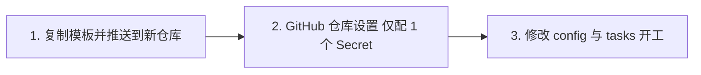

# 🚀 Jules 自动开发模板极速上手指南

本模板专为**“零门槛、极简配置”**设计。无论你是开发 Python、Node.js、Go 还是前端项目，只需将此目录复制到新的 GitHub 仓库中，通过配置 1 个密钥和 1 个 JSON 文件，即可开启 AI 全自动编码与 PR 合并流水线。

---

## ⚡ 极简 3 步上手流程



---

### 第一步：复制模板到你的新项目

#### 方式 A：使用一键初始化脚本（最快）
在主仓库根目录下运行：
```bash
python init_project.py --target-dir ../my-new-project --name "my-project" --context "Python 3.12 FastAPI 后端服务，所有接口用 pytest 测试"
```
脚本会自动将整套模板复制到指定目录，并替换好项目基础配置。

#### 方式 B：手动复制
1. 在 GitHub 上创建一个全新的空仓库（例如 `my-new-project`）；
2. 将 `jules_auto_template/` 下的所有文件复制到你的新项目目录；
3. 初始化并推送到 GitHub：
```bash
cd my-new-project
git init
git add .
git commit -m "feat: initial commit with jules-auto template"
git branch -M main
git remote add origin https://github.com/<你的用户名>/my-new-project.git
git push -u origin main
```

---

### 第二步：GitHub 仓库设置（仅需 1 个 Secret！）

为了让 GitHub Actions 具备无人值守自动合入代码的能力，仅需在你的新仓库中做以下极简设置：

#### 1. 添加唯一必需的 Secret
- 前往仓库 `Settings` $\rightarrow$ `Secrets and variables` $\rightarrow$ `Actions`；
- 点击 **New repository secret**：
  - **Name**: `JULES_API_KEY`
  - **Secret**: 填写你的 Google Jules API Key

> 💡 **无需配置个人访问令牌 (PAT)**：系统已预配置精细的 GitHub Actions Permissions，默认通过自带的 `github.token` 完成代码回写和 PR 操作，无需烦琐创建额外的 Personal Access Token。

#### 2. 勾选 2 个仓库开关（开启自动合入权限）
1. **允许自动合并**：
   - 进入 `Settings` $\rightarrow$ `General` $\rightarrow$ 下拉至 **Pull Requests**；
   - 勾选 **Allow auto-merge**。
2. **授予 Actions 写权限**：
   - 进入 `Settings` $\rightarrow$ `Actions` $\rightarrow$ `General` $\rightarrow$ 下拉至 **Workflow permissions**；
   - 勾选 **Read and write permissions**；
   - 勾选 **Allow GitHub Actions to create and approve pull requests**。

---

### 第三步：修改配置文件，编写你的第一个需求

全部业务定制仅需修改 `automation/` 下的两个文件：

#### 1. 设置项目上下文 `automation/config.json`
定义你的项目架构、代码风格和技术栈规范。Jules 会在每次编写任务时优先遵循这些规范：
```json
{
  "project_name": "my-new-project",
  "project_context": "基于 FastAPI 的现代 RESTful 服务。采用模块化分层设计，数据库使用 SQLAlchemy，所有接口必须在 tests/ 下编写 pytest 单测。",
  "default_max_attempts": 3,
  "auto_merge": true
}
```

#### 2. 编写你的任务列表 `automation/tasks.json`
清空或修改示例任务，填入你的第一个开发需求：
```json
[
  {
    "id": "TASK-001",
    "title": "搭建用户认证与注册接口",
    "description": "在 src/ 下新增 auth 模块，提供 POST /api/register 接口。",
    "acceptance_criteria": [
      "接口接收 username, email, password，对密码进行哈希加密",
      "编写对应单元测试并确保 pytest 通过"
    ],
    "dependencies": [],
    "max_attempts": 3,
    "status": "pending",
    "active_session_id": null,
    "pr_number": null,
    "pr_url": null,
    "failure_history": []
  }
]
```

将修改提交并 Push 到 GitHub：
```bash
git add automation/
git commit -m "chore: configure project and add TASK-001"
git push origin main
```

---

## ☕ 接下来发生什么？

无需任何人工操作，系统会自动进入全闭环运转：
1. **定时轮询/手动触发**：GitHub Actions 每 15 分钟（或你手动点击 Actions -> Run workflow）运行一次 Worker；
2. **AI 理解并编写**：Jules 读取 `TASK-001` 的需求与验收标准，在云端沙箱中完成代码编写并向你的仓库提交 Pull Request；
3. **门禁与测试**：GitHub 自动触发 CI 运行单测；
4. **自动合入**：测试通过后，Worker 会自动触发 Auto-Merge，将代码以 Squash 形式合入 `main`；
5. **状态自动归档**：`automation/tasks.json` 自动将任务标记为 `done` 并持久化回仓库。
